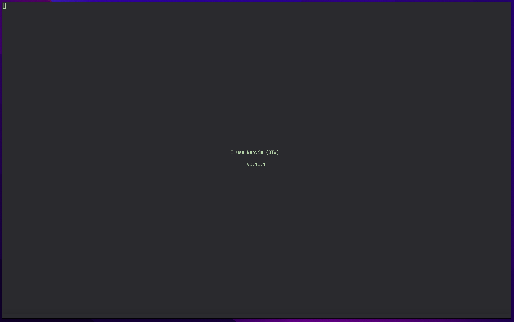

<h1 align="center">
    dotfiles-nvim
</h1>
<div align="center">
  
  
  
  <p>dotfiles v5</p>
</div>



## v3/default dependency graph

The complete v3 profile and graph are available on `aarch64-darwin` (Apple Silicon
macOS), matching the profile's platform-specific plugins and tools.

```sh
# Generate a self-contained HTML file in the current directory.
nix run '.#v3/graph'

# Choose a new output path (parent directory must already exist).
nix run '.#v3/graph' -- ./my-nvim-graph.html

# Or build the immutable HTML directly, without copying it.
nix build '.#v3/graph' --no-link --print-out-paths
```

The app writes `v3-default-graph.html` by default, prints its path, and refuses to
overwrite an existing file or symlink. Open the HTML in a browser to search,
zoom, or inspect inline plugin documentation. It works offline after building;
Nix may need network access to fetch inputs and build dependencies. The app does
not start Neovim or open a browser.

The graph uses exactly the same pinned package set and configuration as
`v3/default`. It describes configured dependencies and load units, not a live
runtime trace. The HTML includes inline docs, Nix store paths, and declaration
locations; review it before sharing. Graphviz is a build-time dependency only.
